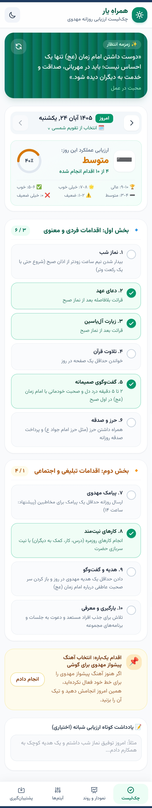
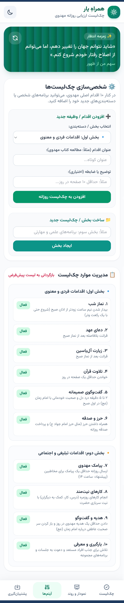
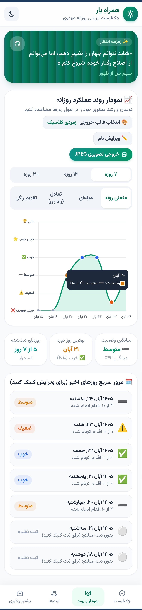
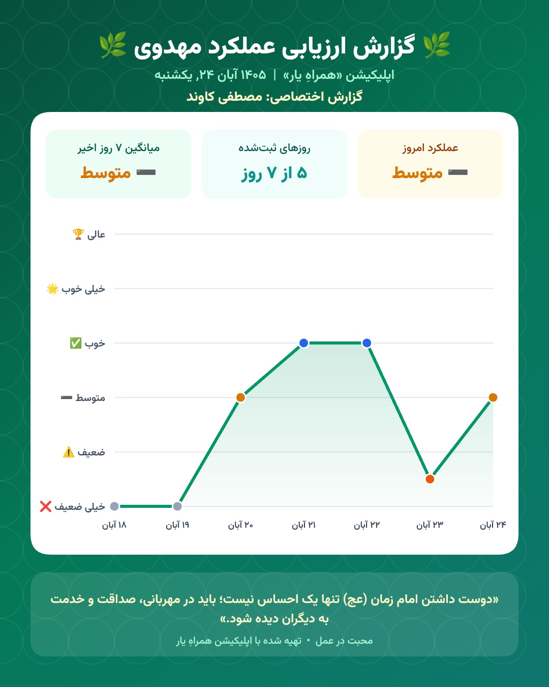
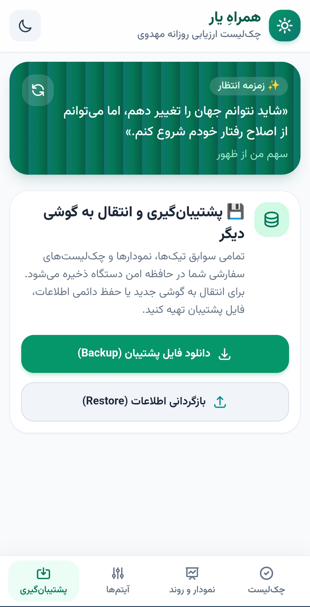

# همراهِ یار | Hamrah-e-Yar 🌿

**چک‌لیست ارزیابی روزانه مهدوی | Daily Mahdavi Evaluation Checklist**

[🇮🇷 فارسی](#فارسی) · [🇬🇧 English](#english)

---

# فارسی

## معرفی

همراهِ یار برنامه‌ای برای ثبت و ارزیابی روزانه اقدامات، پیگیری مسیر خودسازی و مشاهده روند عملکرد شخصی است. این برنامه با رابط فارسی و راست‌چین، تقویم شمسی و امکانات متنوع گزارش‌گیری طراحی شده است.

## 📥 دانلود برنامه

**آخرین نسخه: 2.0.0**

[⬇️ دریافت آخرین نسخه اندروید](https://github.com/mostafakavand/hamrahe-yar/releases/latest)

فایل APK را از صفحه انتشار دریافت و روی دستگاه اندرویدی نصب کنید.

## 🖼️ تصاویر محیط برنامه

|                چک‌لیست روزانه                |              مدیریت آیتم‌ها              |
| :--------------------------------------------------------: | :---------------------------------------------------: |
|  |  |

|       نمودار و گزارش عملکرد       |              گزارش تصویری مهدوی              |
| :-------------------------------------------------: | :----------------------------------------------------------: |
|  |  |

|                  پشتیبان‌گیری                  |
| :--------------------------------------------------------: |
|  |

## ✨ امکانات

- ثبت و ارزیابی روزانه اقدامات
- تقویم شمسی
- ثبت یادداشت‌های روزانه
- مدیریت دسته‌بندی‌ها و آیتم‌های شخصی
- مشاهده سوابق و روند عملکرد
- نمودارهای متنوع شامل نمودار خطی، میله‌ای، راداری و نقشه حرارتی
- انتخاب قالب‌های تصویری متنوع
- خروجی JPEG با پیش‌نمایش
- تغییر نام تصویر خروجی
- اشتراک‌گذاری تصویر
- ذخیره تصویر در گالری گوشی
- حذف تصویر از پیش‌نمایش
- پشتیبان‌گیری و بازیابی اطلاعات
- ویرایش نام کاربر
- رابط کاربری فارسی و سازگار با گوشی‌های اندرویدی

## 📖 راهنمای سریع استفاده

### ۱. شروع کار

در اولین ورود، نام و نام خانوادگی خود را وارد کنید. این نام در گزارش‌های تصویری استفاده می‌شود و بعداً از تنظیمات قابل ویرایش است.

### ۲. ثبت ارزیابی روزانه

به بخش چک‌لیست بروید، تاریخ موردنظر را از تقویم شمسی انتخاب کنید و پس از انجام هر فعالیت، وضعیت آن را علامت بزنید. می‌توانید یادداشت روزانه خود را نیز ثبت کنید.

### ۳. مدیریت آیتم‌ها

در بخش آیتم‌ها، دسته‌بندی‌ها و فعالیت‌های موردنظر خود را مدیریت کنید و در صورت نیاز موارد جدیدی اضافه کنید.

### ۴. مشاهده نمودارها و گزارش‌ها

به بخش نمودار و روند بروید و بازه زمانی و نوع نمودار را انتخاب کنید تا روند عملکرد خود را بررسی کنید.

### ۵. تهیه خروجی تصویری

از بخش گزارش‌ها، خروجی JPEG تهیه کنید. می‌توانید قالب تصویر و نوع نمودار را انتخاب کنید، پیش‌نمایش را ببینید، نام تصویر را تغییر دهید، آن را به اشتراک بگذارید یا در گالری ذخیره کنید.

### ۶. پشتیبان‌گیری و بازیابی

از بخش پشتیبان‌گیری، فایل JSON تهیه کنید و آن را در محل امن نگه دارید. برای بازیابی اطلاعات، فایل پشتیبان را انتخاب کنید.

**توجه:** بازیابی اطلاعات، داده‌های فعلی را با اطلاعات فایل پشتیبان جایگزین می‌کند. پیش از بازیابی، از اطلاعات فعلی نسخه پشتیبان تهیه کنید.

راهنمای کامل فارسی و انگلیسی در فایل [USER-GUIDE.md](./USER-GUIDE.md) قرار دارد.

## 🔄 نصب و به‌روزرسانی

1. آخرین فایل APK را از [GitHub Releases](https://github.com/mostafakavand/hamrahe-yar/releases/latest) دریافت کنید.
2. فایل APK را روی دستگاه اندرویدی اجرا کنید.
3. مراحل نصب را تأیید کنید.

برای به‌روزرسانی نسخه قبلی، نیازی به حذف برنامه نیست؛ نسخه جدید را روی نسخه نصب‌شده اجرا کنید.

## 🔐 حفظ اطلاعات

- اطلاعات برنامه را به‌صورت دوره‌ای پشتیبان‌گیری کنید.
- فایل‌های پشتیبان را در محل امن نگهداری کنید.
- فایل پشتیبان حاوی اطلاعات شخصی را در مخزن عمومی GitHub منتشر نکنید.

## 📜 مجوز

این پروژه تحت مجوز MIT منتشر می‌شود. متن کامل در فایل [LICENSE](./LICENSE) قرار دارد.

## 🤝 مشارکت و گزارش مشکل

برای پیشنهاد قابلیت جدید یا گزارش مشکل، در GitHub یک Issue ثبت کنید.

---

# English

## About

Hamrah-e-Yar is an Android application designed to help users record and evaluate daily activities, follow their personal growth journey, and review their progress over time.

The application features a Persian right-to-left interface, a Solar Hijri calendar, customizable activities, performance charts, and image reports.

## 📥 Download

**Latest version: 2.0.0**

[⬇️ Download the latest Android release](https://github.com/mostafakavand/hamrahe-yar/releases/latest)

Visit the GitHub Releases page and download the APK file for your Android device.

## 🖼️ Screenshots

|                Daily Checklist                |              Manage Activities              |
| :--------------------------------------------: | :-----------------------------------------: |
|  |  |

|              Performance Charts              |               Mahdavi Image Report               |
| :------------------------------------------: | :-----------------------------------------------: |
|  |  |

|              Backup and Restore              |
| :-------------------------------------------: |
|  |

## ✨ Features

- Daily activity tracking and evaluation
- Solar Hijri (Persian) calendar
- Daily notes
- Customizable categories and activities
- Activity history and progress tracking
- Multiple chart types: line, bar, radar, and heatmap
- Customizable image templates
- JPEG report export with preview
- Rename exported images
- Share images
- Save images to the device gallery
- Backup and restore application data
- Editable user name
- Persian right-to-left interface
- Android device support

## 📖 Quick Start Guide

### 1. Getting Started

On the first launch, enter your first and last name. Your name is used in image reports and can be edited later in Settings.

### 2. Daily Evaluation

Open the checklist, select a date using the Solar Hijri calendar, and mark each activity as completed when appropriate. You can also add daily notes.

### 3. Manage Activities

Use the Activities section to manage categories and checklist items. You can add new activities and customize your checklist.

### 4. View Charts and Reports

Open the Charts and Trends section. Select a date range and chart type to review your progress.

### 5. Export Image Reports

Create a JPEG report, choose an image template and chart type, and preview the result. You can rename, share, or save the image to your gallery.

### 6. Backup and Restore

Create a JSON backup and keep it in a safe location. To restore your data, select an existing backup file.

**Important:** Restoring a backup replaces the current application data. Always create a backup of your current data before restoring another file.

For the complete Persian and English user guide, see [USER-GUIDE.md](./USER-GUIDE.md).

## 🔄 Installation and Updates

1. Download the latest APK from [GitHub Releases](https://github.com/mostafakavand/hamrahe-yar/releases/latest).
2. Open the APK on your Android device.
3. Follow the installation instructions.

You do not need to uninstall the previous version before updating. Install the new APK over the existing application.

## 🔐 Data Protection

- Back up your application data regularly.
- Keep backup files in a secure location.
- Do not upload personal backup files to this public repository.

## 📜 License

This project is released under the MIT License. See the [LICENSE](./LICENSE) file for details.

## 🤝 Contributions and Issues

Suggestions, feature requests, and bug reports are welcome. Please open an Issue in this GitHub repository.

---

**Repository:** [mostafakavand/hamrahe-yar](https://github.com/mostafakavand/hamrahe-yar)
